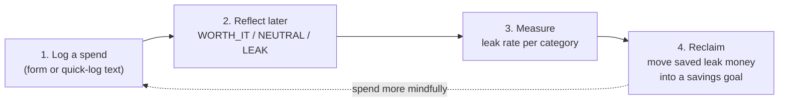
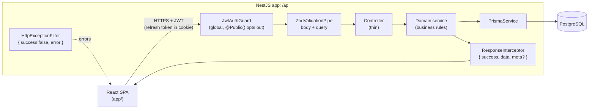
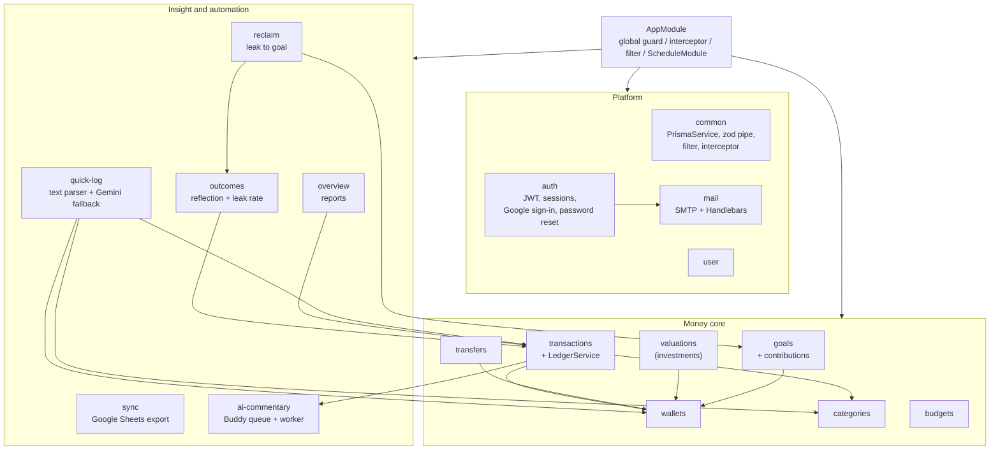
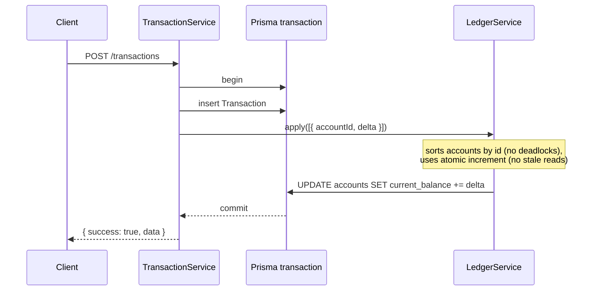
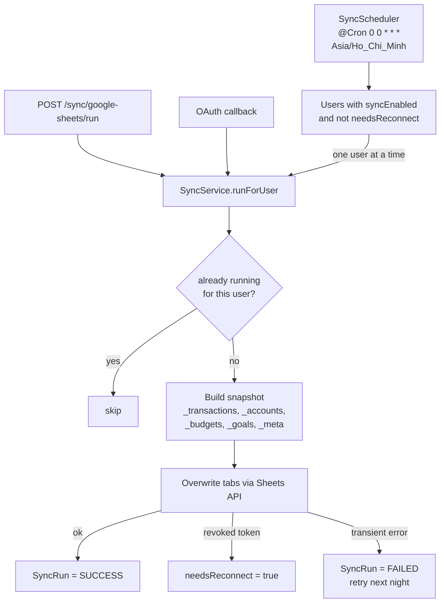
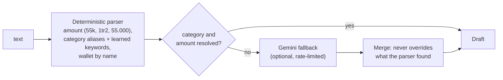
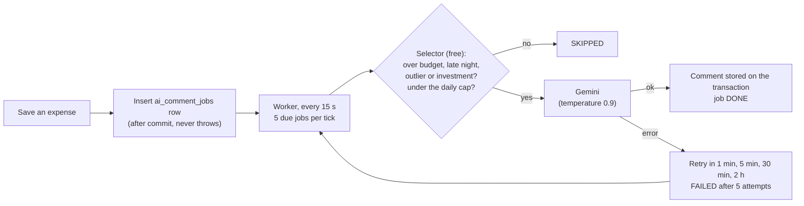
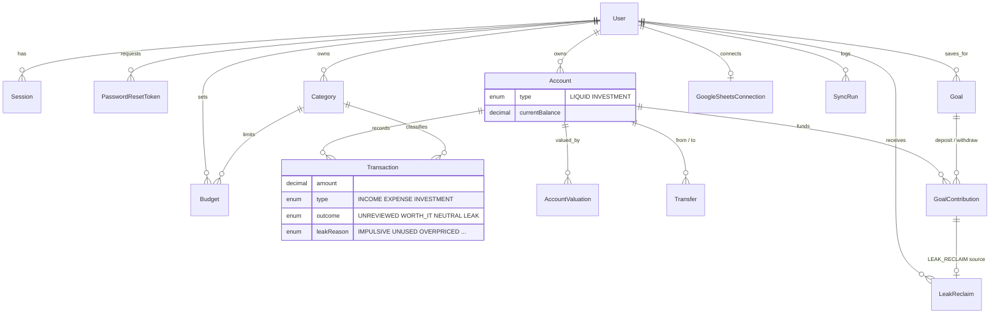
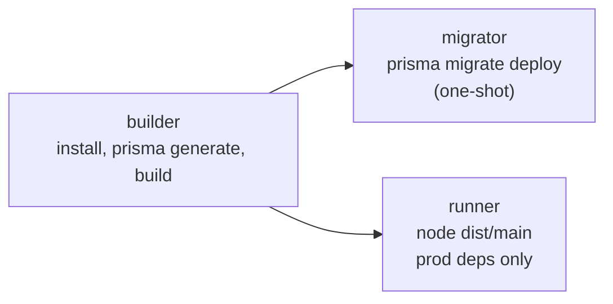

# 💧 Leak API

Backend for **Leak App**, a personal finance tracker that records _why_ money was spent and how much it was worth in hindsight, so subconscious "leaks" show up and can be plugged.

Built with NestJS 11, TypeScript, Prisma 7 and PostgreSQL 16+. Every route is served under the `/api` prefix.

> This README describes what the API **is today** and what is coming.

---

## Table of contents

1. [How it works](#how-it-works)
2. [Architecture](#architecture)
3. [Project structure](#project-structure)
4. [Data model](#data-model)
5. [Features](#features)
6. [Roadmap](#roadmap)
7. [Conventions](#conventions)
8. [Getting started](#getting-started)
9. [Scripts](#scripts)
10. [Deployment](#deployment)

---

## How it works

Leak is built around one feedback loop. The API supports each step:



---

## Architecture

A **modular monolith**: one deployable NestJS app, split into domain modules with thin controllers and services that own the business logic.

### Request lifecycle



- **Global guard**: every route needs a valid JWT unless it is marked `@Public()` (sign-in, sign-up, password reset, the Google OAuth callback).
- **Validation**: every body and query is parsed by a zod schema through `ZodValidationPipe`, with a DTO class implementing `z.infer<typeof schema>`.
- **Envelope**: success returns `{ success: true, data, meta? }`. Errors return `{ success: false, data: null, error: { statusCode, message, error } }`.
- **Controllers never touch Prisma.** Only services and repositories do.
- **Swagger** is served at `/swagger` outside production.

### Module map



### Ledger integrity

Wallet balances are never edited directly. `LedgerService` is the **only writer** of `Account.currentBalance` after a wallet is created, and it always runs inside the caller's Prisma interactive transaction.



Transfers, goal deposits and withdrawals, investment valuations and reclaim transfers all go through the same path, so balances cannot drift from the records behind them.

### Google Sheets sync

Google Sheets is an **export target only**, never a database. Each user connects their own Google account; their refresh token is stored encrypted (AES-256-GCM) and never returned by any endpoint.



Failures are caught, logged, and never block the API. A user's failure never affects another user. Runs on startup mark interrupted `RUNNING` rows as failed.

### Quick-log

`POST /transactions/parse` turns text like `55k phở bò ví tiền mặt` into a draft for the user to confirm. It **never persists** anything.



The Gemini fallback is off unless `GEMINI_API_KEY` and `GEMINI_MODEL` are set.

### AI Buddy

After an expense is saved, a friendly "Buddy" may add a short Vietnamese comment (roast, praise or nudge) to it. Saving never waits on AI: it only inserts one job row after the commit. A worker does the rest in the background.



Only some spends get a comment, at most 3 per user per day. Jobs older than 24 hours are dropped, a user who muted the Buddy since is skipped, and editing a transaction's amount, type, category or note clears its comment. The mode (`SAVAGE`, `GENTLE`, `MUTE`) is read when the job runs. The feature is off unless `AI_BUDDY_ENABLED=true` and the Gemini key and model are set. The worker assumes a single API instance, like sync.

---

## Project structure

```
api/
├── prisma/
│   ├── schema.prisma          # single source of truth for the data model
│   └── migrations/            # applied with `prisma migrate deploy`
├── src/
│   ├── main.ts                # bootstrap: /api prefix, cookies, CORS, Swagger
│   ├── app.module.ts          # module wiring + global guard/interceptor/filter
│   ├── auth/                  # JWT strategy, sessions, password reset, session cleanup cron
│   ├── user/                  # user repository + service
│   ├── common/                # PrismaService, zod pipe, response interceptor, exception filter
│   ├── utils/                 # cookie helper
│   ├── generated/prisma/      # generated Prisma client (do not edit)
│   └── modules/
│       ├── wallets/           # liquid + investment accounts
│       ├── categories/        # income / expense / investment categories
│       ├── transactions/      # CRUD, LedgerService, balance calculator
│       ├── transfers/         # wallet-to-wallet moves
│       ├── valuations/        # investment balance updates, portfolio summary
│       ├── budgets/           # monthly category limits and report
│       ├── goals/             # savings goals + deposit/withdraw ledger
│       ├── outcomes/          # reflection queue, leak-rate calculator
│       ├── reclaim/           # plug-the-leak offers and transfers
│       ├── overview/          # summary, daily/weekly/monthly reports
│       ├── quick-log/         # text parser + Gemini fallback
│       ├── ai-commentary/     # Buddy comments: selector, job queue, worker
│       ├── sync/              # Google Sheets export, OAuth, encryption, scheduler
│       └── mail/              # SMTP mailer + templates
├── test/                      # e2e setup + quick-log eval fixtures
├── scripts/                   # eval-quick-log.ts, probe-gemini.ts, probe-buddy.ts
├── .infras/                   # local PostgreSQL docker-compose
├── .ci/                       # build and version-bump scripts
├── .github/workflows/         # GHCR image publish
└── Dockerfile                 # multi-stage: builder, migrator, runner
```

Each feature module follows the same shape: `*.controller.ts` (thin), `*.service.ts` (rules), `dto/*.dto.ts` (zod schema + DTO class), and pure helpers such as `*.calculator.ts` that are unit-tested without a database.

---

## Data model

PostgreSQL via Prisma. Tables and columns are `snake_case` (`@map` / `@@map`). Every money column is `Decimal(12, 2)`. Financial rows use soft deletes (`isDeleted`) and `onDelete: Restrict`.



---

## Features

Status reflects the code in this repository.

### Shipped

| Area                        | What it does                                                                                                                                                            | Routes                                                               |
| :-------------------------- | :---------------------------------------------------------------------------------------------------------------------------------------------------------------------- | :------------------------------------------------------------------- |
| **Auth and sessions**       | Email sign-up/in, Google sign-in, refresh-token cookie, DB-backed sessions you can list and revoke, forgot/reset password by email, nightly cleanup of expired sessions | `/auth/*`                                                            |
| **Wallets**                 | `LIQUID` and `INVESTMENT` accounts, ledger-backed balances, soft delete                                                                                                 | `/wallets`                                                           |
| **Categories**              | Income / expense / investment categories with emoji, soft delete                                                                                                        | `/categories`                                                        |
| **Transactions**            | Create, edit, delete with date, category, wallet and outcome filters and pagination. Balances stay consistent through the ledger                                        | `/transactions`                                                      |
| **Transfers**               | Move money between your own wallets without touching budgets or leak rate                                                                                               | `/transfers`                                                         |
| **Investments**             | Enter a wallet's current value; the API separates capital from gain or loss and returns a portfolio summary                                                             | `/wallets/:id/valuations`, `/valuations/:id`, `/investments/summary` |
| **Budgets**                 | Monthly limit per category and a progress report                                                                                                                        | `/budgets`                                                           |
| **Savings goals**           | Goals with target dates, deposit/withdraw ledger and contribution history                                                                                               | `/goals`                                                             |
| **Outcome and leak engine** | Reflection queue of unreviewed spends, set an outcome and a leak reason, leak rate per category                                                                         | `/outcomes/*`                                                        |
| **Plug the leak**           | Monthly offer to transfer saved leak money into a goal; accept or dismiss, with history                                                                                 | `/reclaim/*`                                                         |
| **Overview and reports**    | Net worth summary, daily, weekly and monthly breakdowns in one hydrated call                                                                                            | `/overview/*`                                                        |
| **Quick-log**               | Text to a transaction draft: deterministic Vietnamese parser plus optional Gemini fallback (per-user rate limit)                                                        | `POST /transactions/parse`                                           |
| **AI Buddy**                | Optional short comments on a few picked expenses, written in the background with retries. Per-user mode: savage, gentle or mute                                         | `GET /ai-commentary/transactions/:id`, `/users/me/preferences`       |
| **Google Sheets export**    | Per-user opt-in OAuth, nightly export at 00:00 ICT, manual run, run history                                                                                             | `/sync/google-sheets/*`                                              |
| **Mail**                    | SMTP mailer with Handlebars templates (password reset)                                                                                                                  | internal                                                             |

### Status notes

- **Quick-log**: built and evaluated; the Gemini layer stays off until a paid-tier key is configured in production.
- **AI Buddy**: built behind `AI_BUDDY_ENABLED`; stays off until the privacy page describes it and a paid-tier key is set.
- **Google Sheets sync**: built, acceptance testing pending.

---

## Roadmap

```mermaid
flowchart LR
    subgraph P1["Phase 1: Leak engine"]
        P1a["Outcome + reflection"]:::done
        P1b["Leak rate per category"]:::done
    end
    subgraph P2["Phase 2: Automation"]
        P2a["Plug the leak to goal"]:::done
        P2b["Quick-log (text + AI)"]:::review
        P2c["Google Sheets export"]:::review
        P2d["Stealth subscription detector"]:::todo
    end
    subgraph P3["Phase 3: Compounding"]
        P3a["Investment cockpit<br/>(asset classes, PnL)"]:::todo
        P3b["Growth forecast<br/>1 / 3 / 5 / 10 years"]:::todo
        P3c["Advanced sync<br/>bidirectional, CSV/Excel,<br/>monthly reports"]:::todo
    end
    P1 --> P2 --> P3

    classDef done fill:#14532d,stroke:#34d399,color:#ecfdf5
    classDef review fill:#78350f,stroke:#fbbf24,color:#fffbeb
    classDef todo fill:#1e293b,stroke:#64748b,color:#e2e8f0
```



🟢 shipped · 🟡 built, acceptance pending · ⚪ upcoming

### Upcoming

| Item                                        |  Phase  | Notes                                                                                                                                                      |
| :------------------------------------------ | :-----: | :--------------------------------------------------------------------------------------------------------------------------------------------------------- |
| Switch on Gemini quick-log in production    |    2    | Needs a paid-tier key, the privacy page live, and a cost sign-off                                                                                          |
| Quick-log acceptance                        |    2    | Manual check in the running app, plus time-to-log under 5 seconds                                                                                          |
| Google Sheets sync acceptance               |    2    | End-to-end check against a real Google account                                                                                                             |
| **Stealth subscription detector**           |    2    | Detect recurring outflows with uniform intervals, flag unused ones as `FORGOTTEN_SUB` with an estimated yearly waste. Needs a recurring-pattern data model |
| **Investment cockpit**                      |    3    | Asset classes (deposits, gold, stocks/ETFs, real estate, crypto), cost basis, unrealized gain/loss, allocation                                             |
| **Growth forecast**                         |    3    | Show how reclaimed leak money compounds over 1, 3, 5 and 10 years                                                                                          |
| **Advanced sync and export**                |    3    | Bidirectional Sheets sync, on-demand CSV/Excel export, monthly PDF/CSV reports                                                                             |
| Recurring transactions, receipt attachments | backlog |                                                                                                                                                            |
| Budget rollover and alerts                  | backlog |                                                                                                                                                            |
| Sub-categories, multi-currency              | backlog |                                                                                                                                                            |
| Email verification, 2FA                     | backlog |                                                                                                                                                            |
| Lint and test gate in CI                    | backlog | The workflow currently only builds and publishes images                                                                                                    |

---

## Conventions

- **Language**: all code, schemas, routes, logs and comments are English. User-facing text lives in the frontend (Vietnamese).
- **Money**: `Decimal(12, 2)` in the database, never a float. No raw JS numbers for stored amounts.
- **Deletes**: soft delete financial records; `onDelete: Restrict` on ledger relations.
- **Sync calls**: wrapped in `try/catch`, logged, non-blocking, idempotent.
- **Secrets**: never returned in responses or written to logs.
- **Commits**: [Conventional Commits](https://www.conventionalcommits.org/) (`feat:`, `fix:`, `refactor:`, `chore:`, `docs:`), checked by Husky and Commitlint.
- **Path alias**: `@/` maps to `src/`.

---

## Getting started

### Prerequisites

- Node.js 24 (see `.nvmrc`; the Docker image uses Node 22)
- Yarn
- PostgreSQL 16+ (a compose file is provided)

### Setup

```bash
# 1. Install dependencies
yarn install

# 2. Start PostgreSQL (from api/.infras)
docker compose -f .infras/docker-compose.yml up -d

# 3. Configure the environment
cp .env.example .env     # then fill in the values below

# 4. Generate the Prisma client and apply migrations
yarn prisma:generate
yarn prisma:migrate:dev

# 5. Run with hot reload
yarn dev
```

The API listens on `http://localhost:3000/api` (override with `PORT`). Swagger is at `http://localhost:3000/swagger`.

### Environment variables

| Variable                                                                       |  Required  | Purpose                                                |
| :----------------------------------------------------------------------------- | :--------: | :----------------------------------------------------- |
| `DATABASE_URL`                                                                 |    yes     | PostgreSQL connection string                           |
| `JWT_SECRET`                                                                   |    yes     | Signs access tokens                                    |
| `JWT_ACCESS_TTL`, `JWT_REFRESH_TTL`                                            |    yes     | Token lifetimes, e.g. `60m`, `30d`                     |
| `CORS_ORIGINS`                                                                 |    yes     | Comma-separated allowed origins                        |
| `GOOGLE_AUTH_CLIENT_ID`, `GOOGLE_AUTH_CLIENT_SECRET`                           | for Google | Google sign-in, also reused by Sheets sync             |
| `SMTP_HOST`, `SMTP_PORT`, `SMTP_SECURE`, `SMTP_USER`, `SMTP_PASS`, `MAIL_FROM` | for email  | Password reset mail                                    |
| `FRONTEND_URL`                                                                 | for email  | Link target in emails                                  |
| `GOOGLE_SHEETS_REDIRECT_URI`                                                   | for Sheets | Must be an authorized redirect URI on the OAuth client |
| `SYNC_TOKEN_ENCRYPTION_KEY`                                                    | for Sheets | 32 random bytes, base64 (`openssl rand -base64 32`)    |
| `GEMINI_API_KEY`, `GEMINI_MODEL`                                               |  optional  | Quick-log fallback; empty keeps it off                 |
| `GEMINI_TIMEOUT_MS`, `GEMINI_CALLS_PER_MINUTE`                                 |  optional  | Fallback timeout and per-user limit                    |
| `AI_BUDDY_ENABLED`                                                             |  optional  | `true` turns the AI Buddy on (needs the Gemini key)    |

Sheets sync stays unavailable until its variables are set.

---

## Scripts

| Command                          | What it does                                   |
| :------------------------------- | :--------------------------------------------- |
| `yarn dev`                       | Start with watch mode                          |
| `yarn build` / `yarn start:prod` | Compile and run `dist/main`                    |
| `yarn test`                      | Unit tests (Jest, `*.spec.ts` beside the code) |
| `yarn test:e2e`                  | End-to-end tests                               |
| `yarn test:cov`                  | Coverage report                                |
| `yarn lint` / `yarn format`      | ESLint and Prettier                            |
| `yarn typecheck`                 | `tsc --noEmit`                                 |
| `yarn prisma:generate`           | Regenerate the Prisma client                   |
| `yarn prisma:migrate:dev`        | Create and apply a migration locally           |
| `yarn prisma:migrate:deploy`     | Apply pending migrations (production)          |

---

## Deployment

The `Dockerfile` has three useful targets:



- `migrator` applies pending migrations once, as a one-shot compose service.
- `runner` is the production image, with `NODE_ENV=production` and port 3000.
- The GitHub workflow in `.github/workflows/docker-publish.yml` publishes images to GHCR. Local builds use `.ci/build.sh`.

> Sync runs on a single API instance (an in-process lock prevents overlapping runs). Scale out only after moving that lock to the database.
